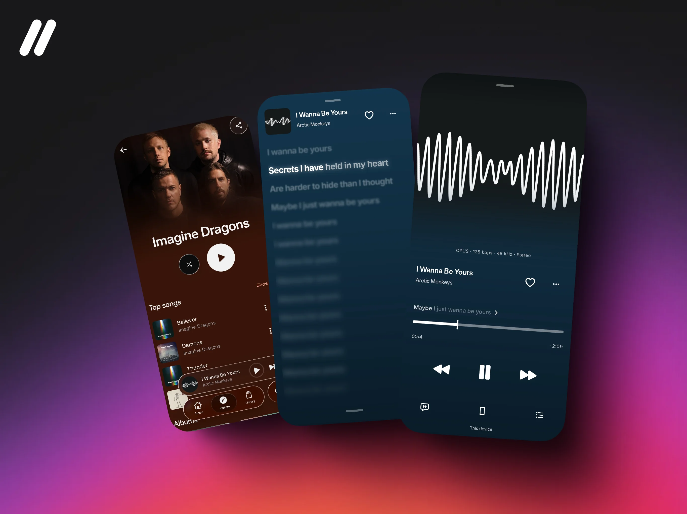
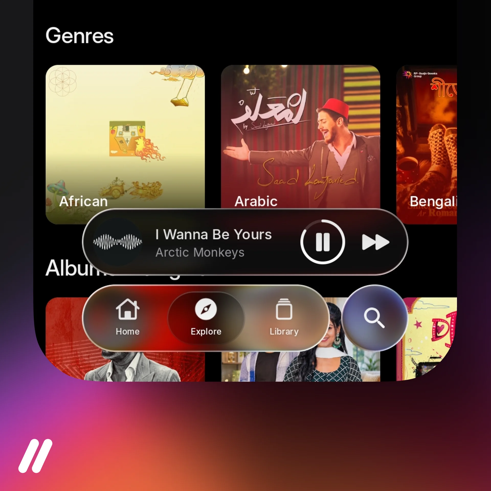
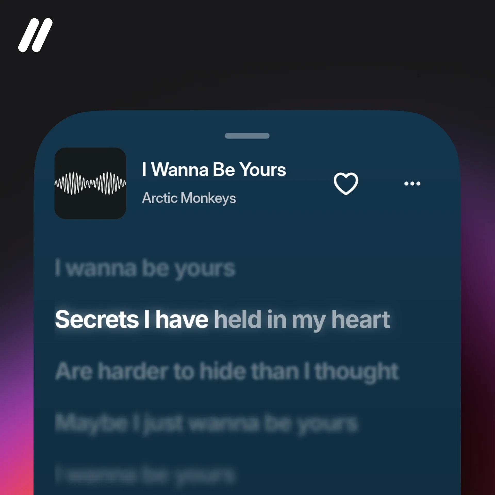
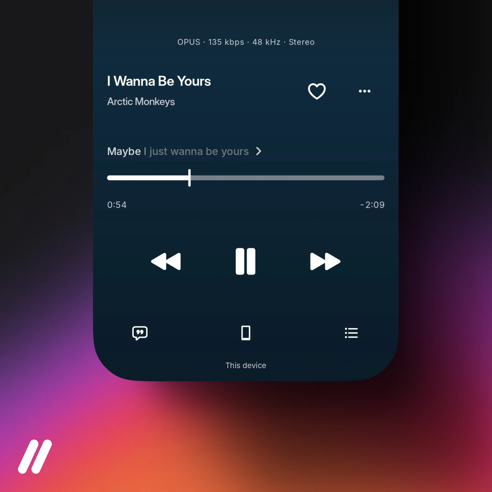

<div align="center">

# Legato

### A music player for the YouTube Music catalogue

[Android](https://img.shields.io/badge/Android-3DDC84?logo=android&logoColor=white) ·
[Kotlin](https://img.shields.io/badge/Kotlin-DB71A8?logo=kotlin&logoColor=white) ·
[License](LICENSE)

[Download](https://github.com/grayguava/legato/releases) ·
[Features](#features) ·
[Build it yourself](#build-it-yourself) ·
[Privacy](#privacy) ·
[License](#license)

</div>

<p align="center">
  
</p>

Free music player for the YouTube Music catalogue, sign in only if you want
your likes and playlists. Android first, desktop and TV later.

| Bottom dock | Lyrics | Player |
|:---:|:---:|:---:|
|  |  |  |
| **Bottom dock**<br>The mini player and the Home, Explore, Library pill, floating over the page. | **Lyrics**<br>The line being sung stays sharp; the rest fades back. | **Player**<br>Codec line, like, scrubber, transport and the output row. |

## Features

- Playback: search, browse and play anything on the catalogue; likes, playlists,
  radio, queue, smart shuffle; local music library.
- Design: frosted glass panels, sheet motion, animated icon buttons, artwork-driven
  accents.
- Controls: like and share in one row, playlists, ringtones, sleep timer, lyrics
  offset, skip silence and crossfade where the audio layer allows.

## Get it

Android phone or tablet: download the APK from the
[releases](https://github.com/grayguava/legato/releases).

## Build it yourself

```
./gradlew assembleDebug
./gradlew testDebugUnitTest
```

You need a JDK and an Android SDK to build. Release signing and the project
layout are documented in the repo.

## Privacy

No ads, no account needed. Sign in only to sync likes and playlists.

## Disclaimer

The screenshots show real albums, artists and songs to show the app as it's
used. Cover art, names and recordings belong to their owners. Legato isn't
affiliated with or endorsed by YouTube, Google or any artist or label shown.

## License

Legato is licensed under the [GNU General Public License v3.0](LICENSE). Code,
libraries, fonts and data from other projects are listed in
[THIRD_PARTY_NOTICES.md](THIRD_PARTY_NOTICES.md), as their licences require.
